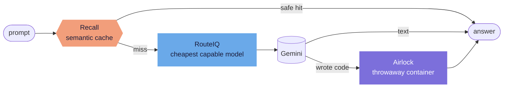

 

B.E. in AI &amp; Data Science · KLE College of Engineering and Technology, Chikodi

 

Most people build the model. I build everything <i>around</i> it. 
The part that picks which model to call, remembers what it already said, 
locks it in a box when it writes code, and shows its work when it gives a score.

 

<h2 align="center">One request, four projects</h2>

Separate repos, one mental model of how a request should travel.

 

<h2 align="center">Receipts</h2>

<table align="center">
  <tr>
    <td align="center" width="25%"><h3>76.5%</h3>cheaper than always-Pro 30.5% from routing alone 224-prompt benchmark</td>
    <td align="center" width="25%"><h3>99.2%</h3>of cached answers correct held-out set, 10 shuffles 100% of injections blocked</td>
    <td align="center" width="25%"><h3>8 of 8</h3>hostile payloads contained fork bombs, memory bombs, exfiltration and more</td>
    <td align="center" width="25%"><h3>170+</h3>automated tests across the four repos, limits written up in each</td>
  </tr>
</table>

 

<h2 align="center">What I've built</h2>

<table>
  <tr>
    <td width="50%" valign="top">
      <h3>💸 <a href="https://github.com/arya251223/routeiq">RouteIQ</a></h3>
      <i>A cost-aware LLM gateway.</i>  
      Scores every prompt across 6 signals in under 0.05 ms, then sends it to Flash-Lite, Flash or Pro. Compresses filler, caches paraphrases, enforces daily budgets and falls back when a model is down. A live dashboard shows what you saved against an always-Pro baseline. Pure Python standard library.  
      <code>Gemini</code> <code>semantic cache</code> <code>budget guard</code> <code>SQLite</code>
    </td>
    <td width="50%" valign="top">
      <h3>🔁 <a href="https://github.com/arya251223/recall">Recall</a></h3>
      <i>A semantic cache that checks before it trusts.</i>  
      A naive cache will happily answer an Enterprise question with the Pro plan's answer. Recall adds an entity guard and a retrieval-consistency guard, so near-duplicate questions with different answers don't collide. It also refuses out-of-scope questions and redacts PII.  
      <code>RAG</code> <code>guardrails</code> <code>MiniLM</code> <code>TTL + LRU</code>
    </td>
  </tr>
  <tr>
    <td width="50%" valign="top">
      <h3>🔒 <a href="https://github.com/arya251223/airlock">Airlock</a></h3>
      <i>A disposable sandbox for AI-written code.</i>  
      Every snippet gets a fresh container with no network, 128 MB of RAM, half a CPU, a 64-process cap, a read-only filesystem and all capabilities dropped. A one-click suite fires 8 hostile payloads and the report shows which limits stepped in.  
      <code>Docker</code> <code>FastAPI</code> <code>cgroups</code> <code>gVisor ready</code>
    </td>
    <td width="50%" valign="top">
      <h3>📜 <a href="https://github.com/arya251223/clauseguard">ClauseGuard</a></h3>
      <i>Contract review that shows its work.</i>  
      Upload a PDF and get a 0 to 100 risk score across 12 clause categories, with the exact trigger words highlighted, missing protections called out and safer wording suggested. A rules engine sets the score. Gemini only explains it, and it can't override it.  
      <code>Flask</code> <code>PDF parsing</code> <code>Gemini</code> <code>explainable AI</code>
    </td>
  </tr>
</table>

Earlier experiments live in <a href="https://github.com/arya251223?tab=repositories">repositories</a>.

 

<h2 align="center">Five rules I build by</h2>

<table align="center">
  <tr>
    <td><b>Route before you spend.</b></td>
    <td>Most prompts don't need the biggest model.</td>
  </tr>
  <tr>
    <td><b>Cache, but check what you cached.</b></td>
    <td>A fast wrong answer costs more than a slow right one.</td>
  </tr>
  <tr>
    <td><b>Trust nothing, sandbox it.</b></td>
    <td>Not even my own code.</td>
  </tr>
  <tr>
    <td><b>Rules decide, models explain.</b></td>
    <td>A score you can't point at isn't a score.</td>
  </tr>
  <tr>
    <td><b>Write the limits down.</b></td>
    <td>Every repo has a section on what it doesn't do yet.</td>
  </tr>
</table>

 

<h2 align="center">What I reach for</h2>

<table align="center">
  <tr><td align="right"><b>Agents &amp; LLMs</b></td><td>CrewAI · LangChain · Ollama · Gemini · MCP</td></tr>
  <tr><td align="right"><b>Deep learning</b></td><td>PyTorch · TensorFlow · Keras · CNNs · Transformers</td></tr>
  <tr><td align="right"><b>Data &amp; ML</b></td><td>scikit-learn · pandas · NumPy · Matplotlib</td></tr>
  <tr><td align="right"><b>Shipping</b></td><td>Python · FastAPI · Flask · Docker · Streamlit</td></tr>
</table>

 

<h2 align="center">Right now</h2>

🔭 &nbsp;Agent safety and LLM cost control &nbsp;·&nbsp; 🌱 &nbsp;Making AI systems explainable 
🎯 &nbsp;Looking for my first AI / ML role, where agents meet real users

  

**If something here made you curious, [say hello](mailto:aryan.carrer@gmail.com).**

 

